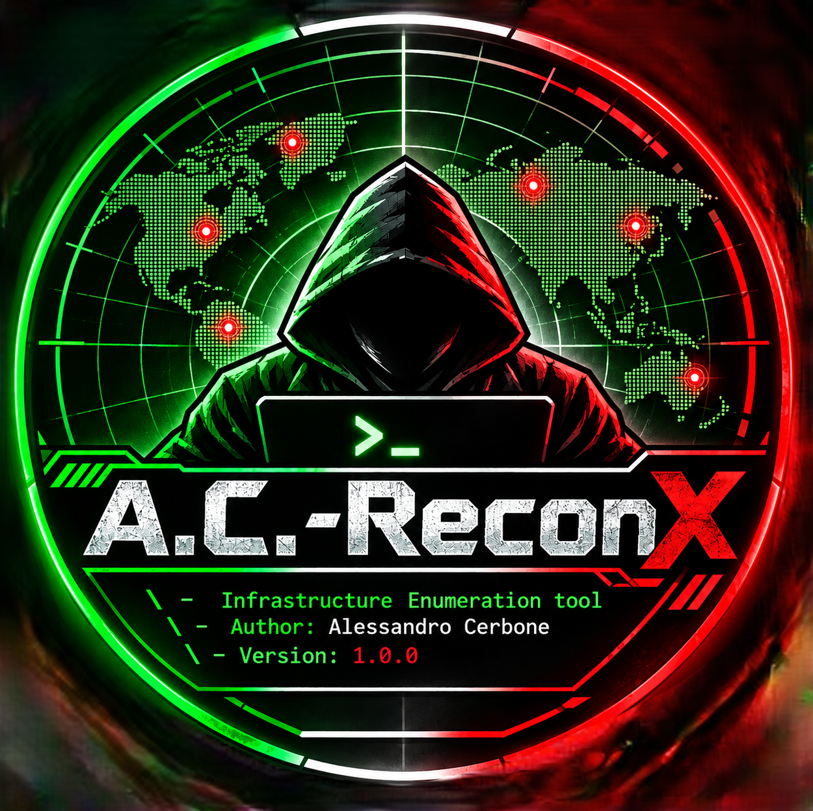
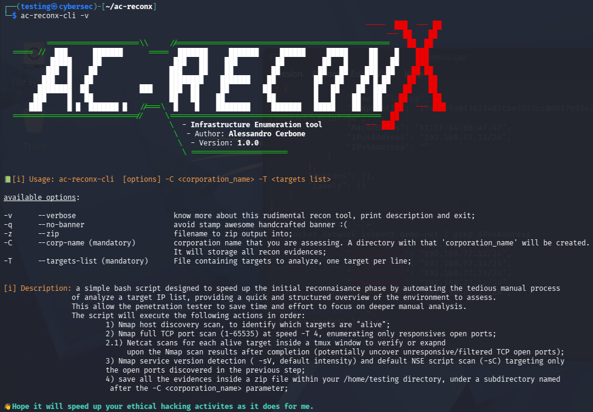
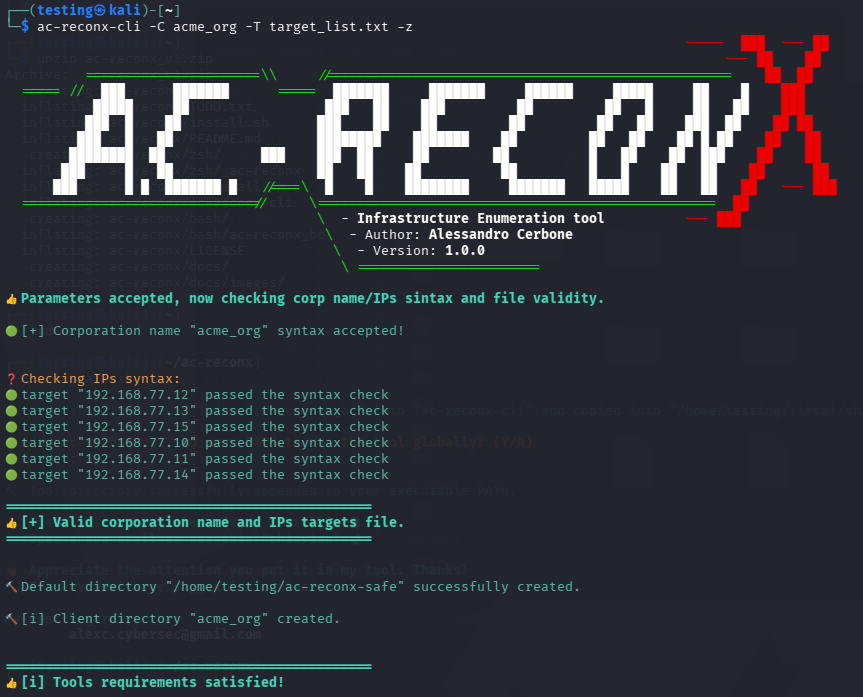
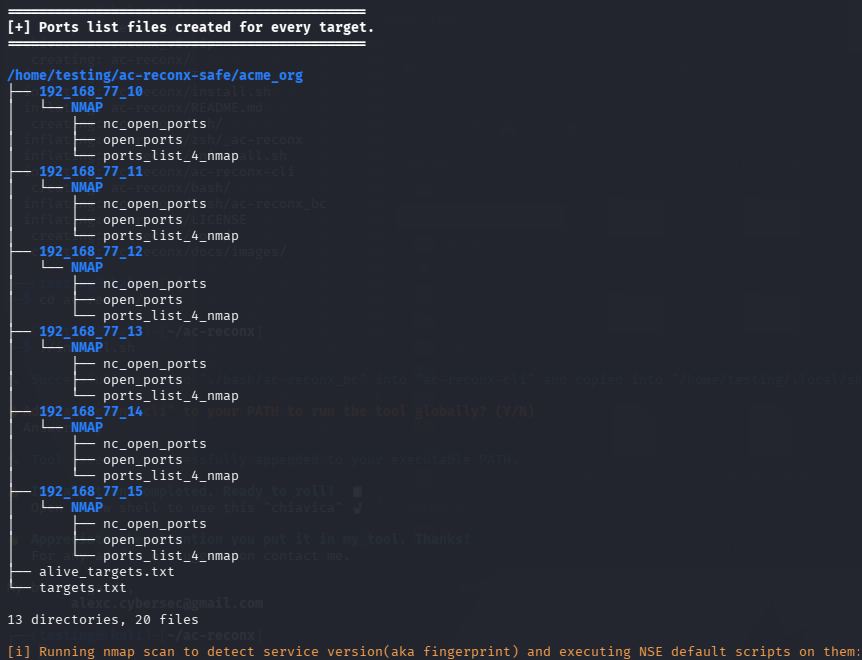
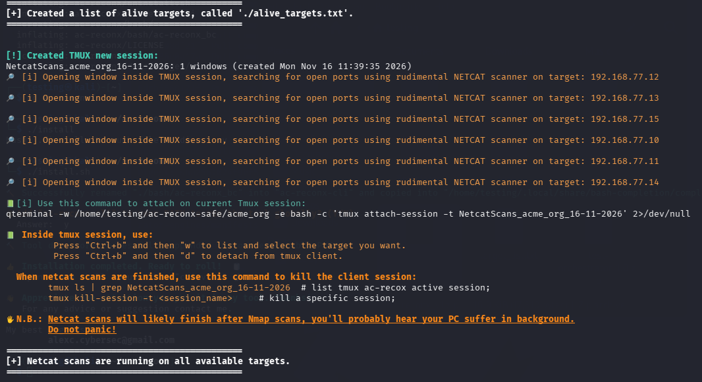
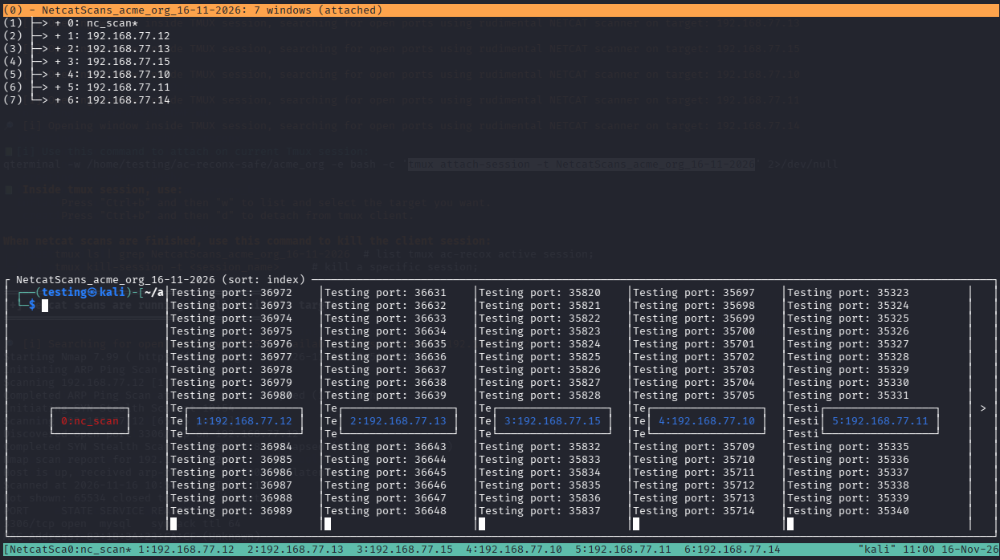
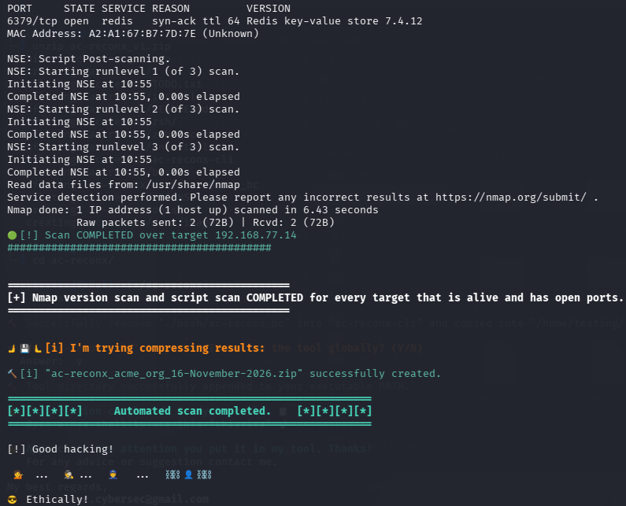
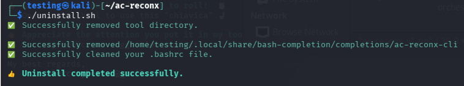

<p></img></p>


# AC-ReconX

**AC-ReconX** is a lightweight Bash-based network reconnaissance tool designed to automate and accelerate the initial reconnaissance phase of infrastructure penetration testing engagements.

## Disclaimer & Motivation

I'm not a professional software developer. AC-ReconX was born out of a practical necessity I encountered during my daily work as a penetration tester.

This project is also my way of giving something back to the cybersecurity community on GitHub, even if only in a small way, in appreciation of the countless open-source tools, resources, and knowledge that have supported my learning journey.

It is my small contribution to that community, and I hope it can be useful to others as well

## Table of Contents

- [Disclaimer & Motivation](#disclaimer--motivation)
- [Compatibility](#compatibility)
- [What is AC-ReconX?](#what-is-ac-reconx)
- [Who is this tool useful for?](#who-is-this-tool-useful-for)
- [Installation](#installation)
  - [Installer](#installer)
  - [Manual Execution](#manual-execution)
- [Shell Autocompletion](#shell-autocompletion)
  - [Bash](#bash)
  - [Zsh](#zsh)
- [Dependencies](#dependencies)
- [Usage](#usage)
- [Uninstall](#uninstall)
- [Screenshots of AC-ReconX in action](#screenshots-of-ac-reconx-in-action)
- [License](#license)
- [Author & Contact](#author--contact)

## Compatibility

AC-ReconX is primarily designed for Debian-based Linux distributions, such as Debian, Ubuntu, and Kali Linux.

The script is written in Bash and can be launched from either Bash or Zsh command-line environments, provided Bash is installed.

The installation script uses apt to install or manage the required dependencies (zip, nmap, netcat-openbsd, and tmux).

Other shells or interpreters, such as sh and dash, are currently unsupported and have not been tested.

## What is AC-ReconX?

AC-ReconX is a simple Bash script designed to speed up the initial reconnaissance and enumeration phase by automating the tedious process of analyzing a list of target IP addresses.

It provides a quick and structured overview of the target environment, helping penetration testers save time and effort and focus on deeper manual analysis.

The script automates the following workflow:

1. **Nmap Host Discovery**
   Performs an initial host discovery scan to identify responsive targets ("alive" hosts) within the provided IP address list.

2. **Nmap Full TCP Port Scan**
   Performs a full TCP port scan (`1-65535`) against identified live hosts using timing template `-T4`, identifying accessible open ports.

3. **Netcat TCP Port Scanning**
   Executes additional Netcat-based full TCP port scans (1-65535) against each live target within dedicated tmux sessions, allowing the user to manually compare the open ports found by Netcat against Nmap's findings to potentially identify additional reachable TCP ports.

4. **Nmap Service Enumeration**
   Performs service version detection (`-sV`, default intensity) and default NSE script scanning (`-sC`) against the open ports identified during the previous scanning phase.

5. **Evidence Collection & Archiving**
   Organizes all generated scan results into a structured directory hierarchy under `$HOME/ac-reconx-safe/`, associated with the specified client/company name (`-C`). Optionally, generates a ZIP archive containing the collected evidence.

## Who is this tool useful for?

I'm currently working as a penetration tester, and quite often I find myself assessing infrastructure IP addresses in black-box scenarios.

These engagements frequently involve multiple targets within scope, requiring a tedious and repetitive manual effort to perform preliminary reconnaissance, enumerate exposed services, and organize the results hierarchically for reporting purposes.

AC-ReconX was created to streamline exactly this process.

If you're looking for a tool that takes care of the repetitive initial reconnaissance work while you focus on analyzing the results, this might be the tool for you.


## Known limitations
- Targets must be specified as individual IP addresses. CIDR notation is currently not supported.
- By default, Nmap performs a full TCP port scan (1-65535). When scanning public-facing systems protected by firewalls or intrusion prevention systems, this may trigger security controls, resulting in connection throttling or temporary source IP blocking. Consider using a quieter or more targeted scanning approach when appropriate.
- Netcat also performs a full TCP port scan (1-65535). Depending on network conditions and target responsiveness, this process can take several hours to complete. For time-constrained assessments, it is recommended to start the scan well in advance.
- This project is independently developed, with AI assistance, and is continuously evolving.

## Installation

Clone the repository:

```bash
git clone https://github.com/alexccybersec/ac-reconx.git
cd ac-reconx
```

### Installer

**Important:** Running the installer is optional. However, it is recommended because it simplifies command execution and enables Bash/Zsh autocompletion. The installer may require sudo privileges to install missing dependencies through apt and configure system-level components. Additionally, running Nmap without sufficient privileges may prevent certain scanning techniques from working as intended. In particular, privileged Nmap execution enables raw packet scanning capabilities that may otherwise be unavailable.


```bash
chmod +x install.sh
./install.sh
```

After installation, open a new terminal session to start using AC-ReconX and its completion functionality.

**NB:** installation can be executed only within tool root directory.

### Manual execution

The installer is not mandatory. You can execute the script directly from the cloned repository:

```bash
chmod +x ac-reconx-cli
```

```bash
./ac-reconx-cli
```

Refer to the built-in help and usage information for additional options and details.

## Shell Autocompletion

AC-ReconX provides shell completion support for Bash and Zsh, allowing users to interact with the CLI more efficiently by using TAB completion.

The completion scripts are included in the repository:

- **Bash:** `bash/ac-reconx_bc`
- **Zsh:** `zsh/_ac-reconx`

The installation script can configure the appropriate completion functionality automatically.

### Bash

Bash completion supports command-line option suggestions and context-aware completion.

### Zsh

Zsh completion provides native completion support through the `_ac-reconx` completion function.


## Dependencies

AC-ReconX relies on the following tools:

- Bash
- Nmap
- Netcat-OpenBSD (`nc`)
- tmux
- zip


## Usage

Display the tool's description and usage information(without running the installer):

```bash
./ac-reconx-cli -v
```
or after successful installation:

```bash
ac-reconx-cli -v
```

Perform reconnaissance against a target IP list:

```bash
ac-reconx-cli -C acme_org -T target_list.txt -z
```

Example of target file list:

```txt
192.168.1.2
10.10.10.10
172.16.15.16
8.8.8.8
```

This command creates a dedicated directory under `$HOME/ac-reconx-safe` for the specified corporation/company name, stores the generated reconnaissance evidence, and optionally packages the collected results into a ZIP archive.

Refer to the built-in help and usage information for additional options and details.

## Uninstall

```bash
cd ac-reconx
chmod +x uninstall.sh
./uninstall.sh
```

**NB:** uninstallation can be executed only within tool root directory.

## Screenshots of AC-ReconX in action

### Banner and usage information



### AC-ReconX tool in action (1)



### AC-ReconX tool in action (2)



### AC-ReconX tool in action (3)



### AC-ReconX tool in action (4)



### AC-ReconX tool in action (5)



### Uninstallation



## Disclaimer

AC-ReconX is intended exclusively for authorized security assessments, penetration testing engagements, and other legitimate security testing activities.

Always ensure that you have explicit authorization to scan the targets you specify.

## License

AC-ReconX is released under MIT License

Copyright (c) 2026 Alessandro Cerbone

See the [LICENSE](LICENSE) file to read full license text.

## Author & Contact

**Alessandro Cerbone**

Email: [alexc.cybersec@gmail.com](mailto\:alexc.cybersec@gmail.com)

If you find AC-ReconX useful, consider giving the repository a ⭐ on GitHub!

---

*I hope AC-ReconX helps speed up your ethical hacking activities as much as it does mine.*
